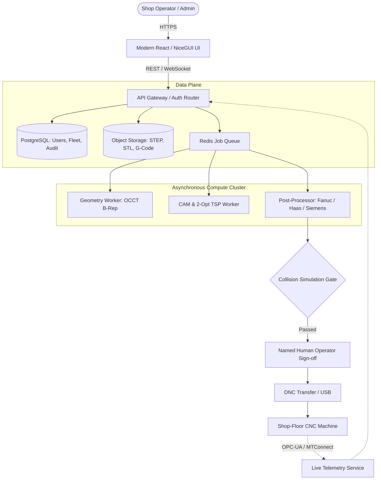

# MECHNOVA — Spare-Parts Industry Case, Impact Model & Production Rollout

> [!IMPORTANT]
> **Read this first (Important for Judges & Evaluators):**  
> Mechnova is a hackathon prototype. We have no live customer and no measured plant data yet, so nothing below is a measured result.
> - **`[SOURCED]`** = Taken from a public industry source (citations at the end).
> - **`[ASSUMPTION]`** = Our engineering planning number. It must be replaced with real figures in a pilot.
> - **`[MODEL]`** = Calculated from the assumptions above it (arithmetic is shown so anyone can re-run it).
> 
> *Saying this openly is stronger than quoting invented "50% savings" numbers; the first thing an experienced manufacturing company or judge will ask is "show me how you measured that."*

---

## 1. Reference Industry: CNC Spare-Parts Job Shops (India)

### Who They Are
Small and mid-size machine shops that machine replacement parts (pump impellers/casings, auto & commercial-vehicle parts, textile-machine components, bushings, brackets, flanges) in small batches (1–500 pcs) from 2D engineering drawings, CAD files, or physical worn samples. 

Spare parts entail **high part variety, short production runs, and frequent changeovers** — exactly where CAM programming overhead, machine setup duration, scrap blanks, and tooling guesswork hurt most.

### Why the Region Fits (Coimbatore as the Reference Cluster)
- **`[SOURCED]` Regional Density**: More than 50,000 engineering units operate in and around Coimbatore; the city's pump/motor industry supplies over 40% of India's requirements; automotive leaders Maruti Suzuki and Tata Motors source up to 30% of specific component categories from there. ([Wikipedia — Economy of Coimbatore](https://en.wikipedia.org/wiki/Economy_of_Coimbatore))
- **`[SOURCED]` Market Growth & Talent Squeeze**: India's turning/CNC machine market is valued at approximately **USD 1.20 billion (2026)**, forecast to reach **USD 2.20 billion by 2031 (12.9% CAGR)**. Automotive and commercial vehicles represent the largest end-use sector at 38%. Small firms are rapidly transitioning from manual lathes to CNC mills, yet CNC operators and toolmakers remain among the hardest industrial roles to hire and retain. ([Mordor Intelligence — India Turning Machine Market](https://www.mordorintelligence.com/industry-reports/india-turning-machine-and-equipment-market))

**Strategic Interpretation**: Small shops are investing heavily in CNC hardware but lack senior, experienced CAM programmers. A system that verifies the design, auto-selects inventory tooling, and plans the machining sequence automatically fills a clear industrial productivity gap.

### The Daily Pain Mechnova Targets

| Typical Job Shop Today | With MECHNOVA Autonomous Suite |
| :--- | :--- |
| Customer sends a drawing, photo, or STEP file. The programmer writes code and only discovers at the machine that a sharp inside corner, deep narrow pocket, or tiny hole cannot be cut by available shop cutters. | Geometry is analyzed automatically on upload. Unmachinable features, thin walls, and inaccessible depths are flagged with DFM warnings before metal is ever cut. |
| Cutters are chosen from the operator's memory. Worn tools are only noticed when a finished part fails inspection or a cutter snaps in the cut. | Cutters are recommended per feature and workpiece material, paired with real-time tool-life counters and automatic "Replace Now" gating. |
| Machine booking is conducted ad-hoc via phone calls, WhatsApp messages, or paper slips. | Workers raise structured machine dispatch requests. Plant admins review scheduled machine capacity, approve, and deploy digitally. |
| Shop management has zero visibility into how many parts an operator completed versus planned target. | Comprehensive project history, % completion, monthly targets vs actuals, and operator sign-offs are tracked continuously. |

---

## 2. Who is Our First Customer?

**Honest Answer:** It is whoever agrees to a structured pilot — we have not signed a commercial customer yet.

### Ideal First Customer Profile
- **Location**: Coimbatore, Pune, or Rajkot tier-2 or tier-3 spare-parts job shop.
- **Shop Scale**: 8–25 CNC machines (vertical machining centers / CNC lathes), running 1–2 shifts.
- **Decision Structure**: Owner-run (single-meeting decision maker) who already uses basic CAM software or programs at the machine console and actively complains about scrap rates, setup delays, or programmer shortages.
- **Target Workpiece Geometry**: Aluminum and mild/alloy steel brackets, flanges, and housings (2.5D prismatic milling, 3-axis) — the exact geometry our computational engine handles first.

### Where to Find Them (Target Outreach List)
1. **Tier-2/3 Vendors in the Ecosystem**: Small vendor shops feeding regional anchors (Pricol, Craftsman Automation, Roots Industries, Lakshmi Machine Works).
2. **Local Industry Associations**: CODISSIA (Coimbatore District Small Industries Association), SIEMA (Southern India Engineering Manufacturers' Association), and Rajkot Engineering Association — requesting 3 member shops for a free 4-week pilot.
3. **Institutional Network**: Job shops owned by university alumni or family networks — the fastest route to acquiring authentic operational data.

### What We Ask for in the Pilot
We ask for **10–20 real past historical jobs** (STEP models, 2D drawings, photos), their actual recorded cycle times, scrap logs, and tool-change records. This creates our empirical before-and-after baseline dataset.

---

## 3. Cost, Time, and Material-Waste Impact

### 3.1 What Evidence Exists for Each Lever
- **Cycle Time**: `[SOURCED]` CGTech (commercial vendor) claims *"25% or more"* cycle-time reduction; independent user tests report 9.7%–19.9% on simple drilling-heavy parts, 30%–51% on complex hard milling, and 37% on a stainless steel test workpiece ([MMS Online](https://www.mmsonline.com/articles/cnc-optimization-software-reduces-cycle-times-25-or-more-and-can-double-tool-life)). *Because our engine is an early-stage prototype, we plan conservatively on significantly lower numbers.*
- **Tooling Costs**: `[SOURCED]` Industrial cost-of-ownership analyses show that tool purchase price represents only ~28%–42% of true tooling cost once changeover downtime and scrap are included ([Fabrico](https://www.fabrico.io/blog/tooling-cost-of-ownership-tracking/)). *The principle (track total tool life and scrap, not just purchase cost) is valid, while the exact percentages are illustrative.*
- **Scrap / Rework Avoidance**: No universal public benchmark exists; treated as an `[ASSUMPTION]` to be empirically measured during the pilot.

### 3.2 Reference Shop Used for the Model
- **`[ASSUMPTION]` Shop Profile**:
  - 10 CNC machines $\times$ 2 shifts $\times$ 8 hours $\times$ 26 days/month = **4,160 scheduled hours/month**.
  - 55% machine utilization (spindle cutting time) = **2,288 cutting hours/month**.
  - Blended machine + operator hourly rate = **₹1,200/hr**.
  - Monthly machining value = $2,288 \times 1,200 \approx$ **₹27.5 lakh/month**.
  - Raw material value $\approx 0.6 \times$ machining value = **₹16.5 lakh/month**.
  - Baseline scrap rate = 3% of combined machining + material value ($\approx$ ₹1.32 lakh/month).
  - Monthly tooling expenditure = 4% of machining value ($\approx$ ₹1.10 lakh/month).

### 3.3 Modelled Savings per Month (10-Machine Shop) `[MODEL]`

| Operational Lever | Conservative | Base Case | Optimistic |
| :--- | :---: | :---: | :---: |
| **Share of cutting hours where optimization applies** | 50% | 60% | 70% |
| **Cycle-time reduction on applicable hours** | 8% | 15% | 22% |
| **Overall shop-wide machining time reduction** | **4.0%** | **9.0%** | **15.4%** |
| **Productive machine hours freed / month** | **92 hrs** | **206 hrs** | **352 hrs** |
| **Value of freed machine hours** (at ₹1,200/hr) | **₹1.10 Lakh** | **₹2.47 Lakh** | **₹4.23 Lakh** |
| **Scrap / rework avoided** (15% / 25% / 35% of baseline) | **₹0.20 Lakh** | **₹0.33 Lakh** | **₹0.46 Lakh** |
| **Tooling expenditure saved** (10% / 15% / 25%) | **₹0.11 Lakh** | **₹0.16 Lakh** | **₹0.27 Lakh** |
| **Total Net Monthly Benefit** | **₹1.41 Lakh** | **₹2.97 Lakh** | **₹4.96 Lakh** |
| **Total Annualized Benefit** | **₹16.9 Lakh** | **₹35.6 Lakh** | **₹59.6 Lakh** |
| **Benefit as % of Machining Value** | **5.1%** | **10.8%** | **18.1%** |

> [!NOTE]
> **Crucial Caveat on Freed Hours:**  
> Freed machine hours translate directly into cash *only if the shop has existing demand/orders to fill those open slots*. Otherwise, the immediate gain manifests as eliminated operator overtime, reduced night-shift fatigue, and faster customer turnaround times. The pilot will track both metrics.

### 3.4 Material Waste — What We Can Honestly Claim
- **Built & Demonstrated in Prototype**: Immediate rejection of unmachinable features and defective geometries *before* blanks are cut, preventing scrapped stock (reflected in the ~₹0.2–0.5 Lakh/month scrap avoided row above).
- **Planned Roadmap (Not Yet Built)**: Automated bounding box + nesting recommendations suggesting the smallest standard rectangular/cylindrical billet size with minimal clamping allowance.
- **Not Claimed**: We make zero claims regarding chip-level or advanced trochoidal material savings beyond the above.

### 3.5 Pricing and Payback Model `[ASSUMPTION]`
- **SaaS Subscription**: ₹7,500 per machine / month $\rightarrow$ **₹75,000/month** (₹9.0 Lakh/year for a 10-machine shop).
- **One-Time Onboarding & Setup**: **₹3.0 Lakh** (tool crib digitization, machine kinematic profiling, operator training).
- **Net Annual Gain (Benefit − Subscription)**:
  - *Conservative*: ₹16.9 L − ₹9.0 L $\approx$ **₹7.9 Lakh/year**
  - *Base Case*: ₹35.6 L − ₹9.0 L $\approx$ **₹26.6 Lakh/year**
  - *Optimistic*: ₹59.6 L − ₹9.0 L $\approx$ **₹50.6 Lakh/year**
- **Payback Period**: 1.5 to 4.5 months (including first-year onboarding fee).
- **The Pilot Guarantee**: *"We only charge subscription fees if the 4-week pilot demonstrates at least an agreed X% reduction in programming/setup time and scrap rates."*

---

## 4. Tolerance and Accuracy — What We Can Promise

To maintain engineering credibility, three distinct levels of precision must never be confused:

```
[Level 1: CAD Software Analysis] ──> [Level 2: DFM Rules & Limits] ──> [Level 3: Physical Machine Tool Holding]
```

### 4.1 Software Analysis Precision

| Input Type | What MECHNOVA Promises | Honest Current Status |
| :--- | :--- | :--- |
| **STEP / STP / STL File** | Dimensional bounding box, hole centers, radii, and pocket depths are extracted mathematically from the geometric model. STEP geometry is exact B-Rep. | Fully functional; automated 2.5D feature detection and mesh repair tested. |
| **Photo / Reference 2D Image** | Approximate contour outline, hole location, and corner detection. Scale is determined by manual length/width input. | Reference only; strictly not intended for final G-code without dimension verification. |

### 4.2 Physical Machining Tolerances
`[SOURCED]` General tolerances for subtractive linear machining per **ISO 2768** (linear dimensions $\pm\text{mm}$):

| Nominal Linear Dimension | Fine Class ($f$) | Medium Class ($m$) |
| :--- | :---: | :---: |
| **0.5 – 3 mm** | $\pm 0.05\text{ mm}$ | $\pm 0.10\text{ mm}$ |
| **3 – 6 mm** | $\pm 0.05\text{ mm}$ | $\pm 0.10\text{ mm}$ |
| **6 – 30 mm** | $\pm 0.10\text{ mm}$ | $\pm 0.20\text{ mm}$ |
| **30 – 120 mm** | $\pm 0.15\text{ mm}$ | $\pm 0.30\text{ mm}$ |

*(Source: [Wevolver — Subtractive Manufacturing Tolerance Standards Overview](https://www.wevolver.com/article/subtractive-manufacturing-tolerance-standards-overview))*

> **Mechnova's Role:** Our software's job is to read user drawing tolerances, compare them against what the selected machine/tool combination can hold, and issue warnings — **not** to make physical machinery magically more precise.

### 4.3 Rules Applied by the DFM Engine
1. **Internal Corner Radius vs Tool Radius**: A rotating cutter cannot machine a sharp $90^\circ$ inside corner. Mechnova flags any internal corner whose fillet radius is smaller than the available cutter radius and recommends either a smaller cutter or corner relief/undercut.
2. **Cavity Depth vs Cutter Diameter ($L/D$ Ratio)**: Deep, narrow cavities cause severe tool deflection and chatter. The engine flags cavity depth when $\text{depth} > 4\times \text{cutter diameter}$ `[ASSUMPTION: standard shop rule of thumb]`.
3. **Thin Wall & Micro-Hole Thresholds**: Features below configured thresholds are flagged as non-machinable.
4. **Tool-Life Gate**: Any cutter whose wear counter reaches $\ge 90\%$ of rated tool life is locked out until replaced.

### 4.4 Pilot Success KPIs

| Metric / KPI | Target Benchmark | Verification Method |
| :--- | :---: | :--- |
| **Feature Detection Recall on STEP Parts** | $\ge 95\%$ | Compared against designer's feature sheet on 20 benchmark parts |
| **False Alarms per Part** | $\le 1$ | Operator review log |
| **Dimensional Agreement (STEP $\rightarrow$ Report)** | $\le 0.01\text{ mm}$ | Automated regression comparison |
| **Programming + Setup Time per New Part** | **$-30\%$ vs Baseline** | Time-tracking log before and after adoption |
| **First-Article Pass Rate** | $\ge \text{Baseline} + 5\text{ pts}$ | Quality inspection inspection logs |
| **Scrap Rate Reduction** | **$-20\%$** | Shop scrap weight register |
| **Dry-Run Machine Collisions** | **$0$** | G-code simulation and operator sign-off |

---

## 5. Production Rollout Plan: From Prototype to Factory Floor

### 5.1 Prototype Status vs Production Roadmap
- **Built in Current Prototype**:
  - Worker & Admin authentication, role separation.
  - Multi-tenant machine, operator, and allocation workflow.
  - Interactive 3D WebGL preview and feature highlighting.
  - In-process resilient CAD feature extraction (holes, blind holes, pockets, slots).
  - Tool crib inventory matching, wear tracking, and replace workflows.
  - Job slip generation and project history tracking.
- **Production Roadmap (To Build in Pilot)**:
  - Machine-specific G-code post-processors (Fanuc $0i$, Siemens 828D, Haas NGC).
  - 3D kinematic machine-envelope collision simulation.
  - Live machine telemetry integration (OPC-UA / MTConnect).
  - Multi-tenant PostgreSQL database with automated backups.

### 5.2 Phased Rollout Schedule

```mermaid
gantt
    title MECHNOVA Production Pilot Roadmap
    dateFormat  WW
    axisFormat  Wk %W
    section Phase 0 & 1
    0. Scope & Pilot Agreement       :done, p0, 00, 1w
    1. Baseline Data & Discovery     :done, p1, after p0, 2w
    section Phase 2 & 3
    2. Engine Hardening & Post-Proc  :active, p2, after p1, 7w
    3. Shadow Mode (No Spindle Run)  :p3, after p2, 4w
    section Phase 4 & 5
    4. Supervised Production Cutting :p4, after p3, 6w
    5. Fleet Scale & ERP Link        :p5, after p4, 8w
```



| Phase | Duration | Objective | Exit Criterion |
| :--- | :---: | :--- | :--- |
| **0. Select & Scope** | Wk 0–1 | Select 1 pilot machine shop; sign pilot data and safety agreement. | Signed KPI agreement sheet. |
| **1. Discovery** | Wk 1–3 | Collect 20 real historical production jobs, tool crib records, machine specs, and scrap logs. | Baseline operational data established. |
| **2. Engine Hardening** | Wk 3–10 | Fine-tune B-Rep parsing, populate actual customer tool inventory, develop 1 machine post-processor (e.g. Fanuc). | $\ge 95\%$ feature recall on the 20 benchmark parts. |
| **3. Shadow Mode** | Wk 10–14 | Run Mechnova in parallel with current human programmers; no unvalidated code touches machine spindles. | Plans match or beat manual programming on $\ge 80\%$ of parts. |
| **4. Supervised Production** | Wk 14–20 | Release Mechnova programs to CNC machines with strict operator dry-run and dual sign-off. | **0 collisions**; target KPIs met across 50 production parts. |
| **5. Scale & Integration** | Wk 20+ | Expand across machine fleet; integrate ERP/MES; provide ongoing SLA support. | Converted to paying SaaS customer. |

### 5.3 Target Production Architecture



### 5.4 Deployment, Security & Operations Checklist
- **Enterprise Security**: Hashed credentials (bcrypt/Argon2), short-lived JWT access tokens with rotation, role-based access control (`worker` vs `admin`), and HTTPS enforcement.
- **Data Confidentiality**: Customer CAD models and part drawings remain strictly confidential; per-tenant isolation, encrypted storage at rest, and optional **on-premises deployment** for factories with strict IP security requirements.
- **Audit Trails**: Complete non-repudiation logging: who uploaded the model, who approved the tool selection, which post-processor version was used, and who authorized G-code release.
- **Change Management Strategy**: Mechnova does *not* seek to replace shop programmers. It acts as an intelligent assistant providing a **"first draft + automatic sanity check"**, earning shop-floor trust through transparency.

### 5.5 Risk Management Matrix

| Operational Risk | Severity | Engineered Mitigation |
| :--- | :---: | :--- |
| **Generated G-code causes tool breakage or machine collision** | Critical | Mandatory virtual collision simulation, dry-run air-cutting protocol, shadow mode testing, and non-negotiable named operator sign-off before cycle start. |
| **Image-based inputs mistaken for precise production geometry** | High | UI prominently badges image uploads as *"Reference & Estimation Only"*. Production G-code export is strictly restricted to valid B-Rep STEP/STL inputs with confirmed dimensions. |
| **Customer tooling differs from default catalog** | Medium | Tool crib ingestion module imports the shop's real tool inventory, holder clearances, and gauge lengths during onboarding Phase 1. |
| **Shop floor resistance or slow adoption** | Medium | Intuitive 3-click operator wizard, localized terminology, mobile/tablet compatibility, and clear visual demonstrations of setup time saved per shift. |
| **Factory data privacy restrictions** | High | Turnkey on-premises Docker containerized deployment option eliminating external cloud transmission of proprietary customer geometry. |

---

## 6. The 60-Second Pitch (Use as-is)

> *"Spare-parts machine shops lose money in three recurring places: they discover a feature cannot be machined after hours of programming, they guess cutting tools from memory and ruin parts with worn cutters, and they manage machine bookings through paper or phone calls.*  
> 
> *MECHNOVA inspects geometry upon upload, matches cutting tools against actual inventory with real-time tool-life tracking, and routes work orders through an approved digital machine schedule.*  
> 
> *For a standard 10-machine job shop, our planning model—using conservative assumptions we will verify empirically in a pilot—projects approximately **4% less machining time**, **15% less scrap**, and **10% less tool spend**, translating to roughly **₹17 lakh in annual bottom-line benefit** at the conservative end.*  
> 
> *We are not claiming these numbers are measured yet; we are looking for a **4-week shop-floor pilot** to prove them with real production parts."*

---

## Sources & Industry Citations

1. [Economy of Coimbatore — Wikipedia](https://en.wikipedia.org/wiki/Economy_of_Coimbatore)
2. [India Turning Machine and Equipment Market — Mordor Intelligence](https://www.mordorintelligence.com/industry-reports/india-turning-machine-and-equipment-market)
3. [CNC Optimization Software Reduces Cycle Times 25% or More — MMS Online (CGTech)](https://www.mmsonline.com/articles/cnc-optimization-software-reduces-cycle-times-25-or-more-and-can-double-tool-life)
4. [Tooling Cost of Ownership Tracking — Fabrico](https://www.fabrico.io/blog/tooling-cost-of-ownership-tracking/)
5. [Subtractive Manufacturing Tolerance Standards Overview — Wevolver](https://www.wevolver.com/article/subtractive-manufacturing-tolerance-standards-overview)
