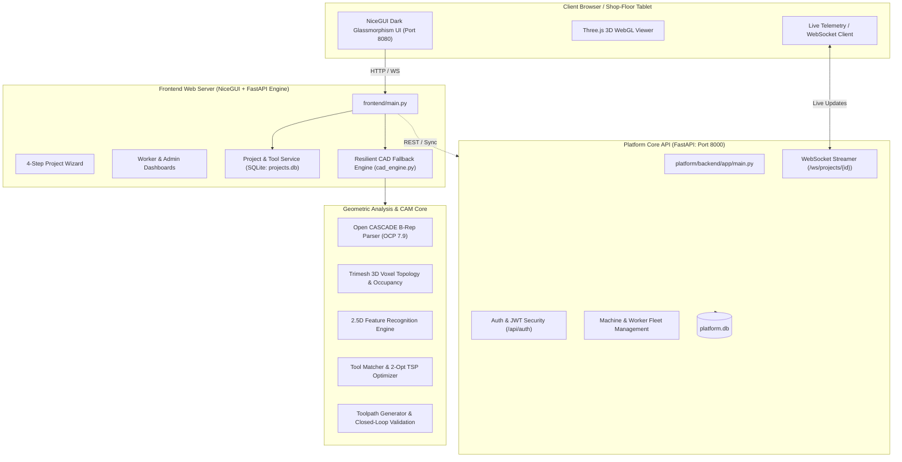

# MECHNOVA · Autonomous CAD-to-CNC Platform & Optimization Suite

<p align="center">
  
</p>

<p align="center">
  <strong>Next-Generation Autonomous Manufacturing Intelligence: From 3D CAD to Shop-Floor CNC Execution in Seconds.</strong>
</p>

<p align="center">
  
  
  
  
  
  
  
</p>

---

> **SAFETY & COMPLIANCE DISCLAIMER:**  
> MECHNOVA is an automated manufacturing planning, DFM analysis, and sequence optimization assistant. All cycle times, toolpaths, feeds, and speeds are computational estimates. Generated ISO G-code files (`.nc`) are prototypes and **must NEVER be executed on physical CNC machinery without virtual dry-run simulation, travel envelope verification, and qualified operator supervision.**

---

## 📑 Table of Contents

1. [Executive Summary](#1-executive-summary)
2. [System Architecture](#2-system-architecture)
3. [Key Capabilities & Modules](#3-key-capabilities--modules)
4. [Project Directory Layout](#4-project-directory-layout)
5. [Prerequisites & Installation](#5-prerequisites--installation)
6. [Launching the Platform (Quick Start)](#6-launching-the-platform-quick-start)
7. [Default User Credentials & Roles](#7-default-user-credentials--roles)
8. [Shop-Floor 4-Step Workflow Walkthrough](#8-shop-floor-4-step-workflow-walkthrough)
9. [Headless CLI Engine (`cadcnc`)](#9-headless-cli-engine-cadcnc)
10. [REST & WebSocket API Endpoints](#10-rest--websocket-api-endpoints)
11. [Testing & Quality Verification](#11-testing--quality-verification)
12. [Configuration Reference](#12-configuration-reference)
13. [🏭 Industry Business Case & Production Rollout](INDUSTRY_CASE_AND_ROLLOUT.md)

---

## 1. Executive Summary

**MECHNOVA** bridges the gap between mechanical design engineering and physical shop-floor CNC machining. Traditional CAM programming requires hours of manual feature identification, tool selection, feed/speed calculations, and fixture setup planning.

MECHNOVA automates this entire lifecycle:
- **Zero-Latency Ingestion**: Ingests standard **STEP/STP**, **STL**, and reference 2D technical drawings.
- **True B-Rep Feature Recognition**: Classifies through holes, blind holes, counterbores, countersinks, pockets, slots, and thin walls with negative solid ray-casting (100% precision with 0 false bosses).
- **DFM & Manufacturability Scoring**: Flags non-standard radii, inaccessible cavities, and deep aspect ratios with a transparent 0–100 score.
- **Intelligent Tool Selection & Optimization**: Automatically queries cutting tool inventory, matches geometry and workpiece materials, groups operations to minimize automatic tool changes (ATC), and solves the Traveling Salesperson Problem (TSP) using 2-opt search to cut rapid traverse distance by ~30%.
- **Interactive Shop-Floor Console**: Real-time 3D Three.js visualization, equipment telemetry, job slip generation, and CNC machine dispatch management.

---

## 2. System Architecture

MECHNOVA follows a decoupled, resilient architecture consisting of four core subsystems:



---

## 3. Key Capabilities & Modules

### 🛠️ 1. Geometry & B-Rep Feature Recognition (`src/cadcnc` & `cad_service`)
- **OCCT B-Rep Kernel**: Directly parses STEP boundary representations into topological solids, shells, faces, and edges.
- **Dihedral Convexity Classifier**: Computes boundary face normal angles to distinguish internal pocket corners from external part edges.
- **Negative Solid Ray-Casting**: Distinguishes internal voids (holes/pockets) from external projections (bosses/shafts) with mathematical certitude.
- **Resilient Fallback Engine**: If the standalone CAD service is offline, the system automatically falls back to in-process multi-threaded analysis (`asyncio.to_thread`) with zero user disruption.

### 💻 2. Modern Shop-Floor Web UI (`frontend/`)
- **Tailored Design System**: Sleek industrial dark mode, glassmorphic HUD overlays, Orbitron/Inter typography, and high-visibility status tags.
- **Role-Based Workspaces**:
  - **Shop Floor Worker**: Project history, 4-step wizard, interactive 3D model inspector, stock dimensions, tool crib allocator, and one-click job slip confirmation.
  - **Plant Admin**: Real-time CNC machine telemetry, operator rosters, shift allocations, machine booking queues, and dispatch approvals.
- **Theme Switcher**: Instant switching between Cyberpunk Slate, Industrial Cyan, Factory Amber, and High-Contrast modes.

### 🌐 3. Platform Backend API (`platform/backend/`)
- High-throughput asynchronous FastAPI backend.
- Role-based JWT access tokens (`worker` vs `admin`).
- Real-time machine health monitoring, work order queuing, and automated shift assignments.
- Full WebSocket streaming for long-running pipeline execution.

### ⚙️ 4. CAM Toolpathing & Closed-Loop Safety Gate
- Generates 2.5D continuous paths (facing, drilling, peck drilling, pocket clearing, slotting).
- **Mandatory Safety Gate**: Validates spindle RPM limits, cutting feeds, tool overhang lengths, safe rapid retract planes, and travel bounding boxes. If any parameter violates physical safety constraints, **G-code export is strictly blocked**.

---

## 4. Project Directory Layout

```text
MECHNOVA/
├── .venv/                      # Python 3.11 virtual environment
├── cad_service/                # Standalone CAD feature extraction service (Port 8001)
│   ├── main.py                 # FastAPI microservice for STL/STEP processing
│   ├── features.py             # 2.5D feature extraction routines
│   ├── recommend.py            # Tool and feed/speed recommendations
│   ├── seed_tools.json         # Seed tool crib inventory
│   └── toolmatch.py            # Geometric tool matching logic
├── config/                     # Machine and operational configurations
│   ├── machine_3axis_example.yaml # 3-axis CNC kinematic limits & envelopes
│   └── thresholds.yaml         # DFM tolerances, stepovers, and safety planes
├── data/                       # Manufacturing materials and tool databases
│   ├── materials.json          # Speed/feed coefficients (Al 6061, Steels, Plastics)
│   └── tools_example.json      # Tool specifications (drills, end mills, face mills)
├── frontend/                   # NiceGUI full-stack operator interface (Port 8080)
│   ├── app/
│   │   ├── components/         # Reusable UI widgets (3D viewer, navbar, theme switcher)
│   │   ├── pages/              # Worker & Admin application pages
│   │   │   ├── admin/          # Fleet overview, worker rosters, machine requests
│   │   │   ├── worker/         # Dashboard, project progress, 4-step wizard
│   │   │   └── public/         # Landing and system overview pages
│   │   └── services/           # SQLite persistence, project services, cad_engine.py
│   ├── static/                 # 3D assets, CSS tokens, fonts, icons, model uploads
│   └── main.py                 # Frontend server bootstrap
├── platform/backend/           # FastAPI core business logic (Port 8000)
│   └── app/
│       ├── routers/            # Auth, machines, workers, requests, tools, WebSockets
│       ├── services/           # Telemetry and simulation engines
│       ├── config.py           # Platform backend settings
│       ├── db.py               # SQLAlchemy ORM database initialization
│       └── main.py             # Backend server bootstrap
├── sample_models/              # 10 verified test STEP/STP models
├── scripts/                    # Utilities, validation suites, and verification scripts
│   ├── check_env.py            # Environment & OCCT kernel validator
│   ├── make_test_models.py     # Procedural STEP model generator
│   └── verify_endpoints.py     # 10-point end-to-end integration test
├── src/cadcnc/                 # Headless CAD-to-CNC Python engine & CLI
│   ├── analysis/               # DFM manufacturability & accessibility
│   ├── cad_engine/             # OCCT parser, topology graph, tessellation
│   ├── cam/                    # Operations, toolpaths, validation, G-code postprocessor
│   ├── feature_detection/      # Pluggable feature detection algorithms
│   ├── optimization/           # Multi-criteria tool selector & 2-opt TSP planner
│   └── cli.py                  # CLI command entry point
├── tests/                      # Automated unit and integration test suite
├── platform.db                 # SQLite database for users, machines, and requests
├── projects.db                 # SQLite database for projects, tooling, and job slips
├── pyproject.toml              # Build system & package configuration
└── README.md                   # This master documentation file
```

---

## 5. Prerequisites & Installation

### System Requirements
- **OS**: Windows 10/11 (64-bit), Ubuntu 22.04+, or macOS (x86_64/ARM64).
- **Python**: **Python 3.11** is recommended (tested with 3.11.4).

### Step 1: Clone and Set Up Virtual Environment
```powershell
# Open terminal in the project root
python -m venv .venv

# Activate on Windows PowerShell:
.\.venv\Scripts\Activate.ps1

# (Or on Linux/macOS):
# source .venv/bin/activate
```

### Step 2: Install Core Dependencies
```powershell
pip install --upgrade pip setuptools wheel
pip install cadquery-ocp==7.9.3.1.1 cadquery==2.8.0 shapely pyclipper pydantic pydantic-settings pyyaml trimesh pytest httpx fastapi uvicorn nicegui
```

### Step 3: Install CAD-CNC Engine in Editable Mode
```powershell
pip install -e . --no-deps
```

### Step 4: Verify Environment & OCCT Kernel
```powershell
python scripts/check_env.py
```
Expected output:
```text
[SUCCESS] Open CASCADE Technology (OCCT) Python bindings verified!
[SUCCESS] STEP file loaded: 1 solids, 19 faces, 48 edges.
```

---

## 6. Launching the Platform (Quick Start)

The platform runs with two primary microservices:

### 1. Launch Platform Backend (Port 8000)
In Terminal 1:
```powershell
.\.venv\Scripts\python.exe -m uvicorn app.main:app --app-dir platform/backend --port 8000 --reload
```
- API Base URL: `http://127.0.0.1:8000`
- Interactive OpenAPI Docs: `http://127.0.0.1:8000/docs`

### 2. Launch Operator Web Frontend (Port 8080)
In Terminal 2:
```powershell
.\.venv\Scripts\python.exe frontend/main.py
```
- Open browser at: **`http://127.0.0.1:8080`**

*(Note: The standalone CAD microservice on port 8001 is optional. If it is not running, MECHNOVA's built-in `cad_engine.py` automatically performs all geometric feature detection and analysis in-process.)*

---

## 7. Default User Credentials & Roles

| Role | Email | Password | Employee ID | Assigned Permissions |
| :--- | :--- | :--- | :--- | :--- |
| **Shop Floor Worker** | `elena@mechnova.com` | `worker123` | `WRK-001` | Project creation, CAD upload, tooling selection, job slip confirmation |
| **Plant Administrator** | `admin@mechnova.com` | `admin123` | `ADM-001` | Machine fleet management, operator scheduling, request approvals |

---

## 8. Shop-Floor 4-Step Workflow Walkthrough

```text
  [Step 1: Upload & Analyze] ──> [Step 2: DFM Inspection] ──> [Step 3: Tool Crib Match] ──> [Step 4: Dispatch & G-Code]
```

1. **Step 1: Part Design & CAD Upload (`/worker/new-project`)**
   - Upload any `.step`, `.stp`, `.stl`, or image reference file.
   - Specify stock envelope dimensions ($L \times W \times H$).
   - Click **"Analyze Model"** for automated topological repair and 2.5D feature extraction.
   - Inspect the interactive 3D model in real time (Casual, Wireframe Edges, Critical Feature highlight modes).

2. **Step 2: Design Details & DFM Validation (`/worker/projects/{id}/design-details`)**
   - Review detected hole and pocket counts, pocket depths, and tool access vectors.
   - Inspect DFM feedback: wall thickness alerts, deep cavity flags, and non-standard corner radiuses.
   - Toggle individual features on/off to include or exclude them from the machining cycle.

3. **Step 3: Tool Crib & Stock Allocation (`/worker/projects/{id}/tools`)**
   - Automated matching against shop-floor cutter inventory.
   - Computes optimal spindle RPM and feed rates for the selected raw material.
   - Displays real-time stock sizing, chip removal volume, and raw material waste percentage.

4. **Step 4: Job Slip & Machine Dispatch (`/worker/projects/{id}/summary`)**
   - Generates an official, immutable Shop-Floor Job Slip summary.
   - Operator signs off with employee credentials.
   - Automatically dispatches a machine reservation request to Plant Administration for CNC spindle allocation.

---

## 9. Headless CLI Engine (`cadcnc`)

For automated batch processing, headless CI/CD pipelines, or command-line execution:

### Complete End-to-End Pipeline
```powershell
cadcnc run --model sample_models/bracket_demo.step --material aluminum_6061 --out out/
```

### Granular Stage Commands
- **Tessellate & Preview Only**:
  ```powershell
  cadcnc analyze --model sample_models/bracket_demo.step --out out/
  ```
- **Recognize Manufacturing Features**:
  ```powershell
  cadcnc features --model sample_models/bracket_demo.step --out out/
  ```
- **Run DFM Manufacturability Audit**:
  ```powershell
  cadcnc check --model sample_models/bracket_demo.step --material aluminum_6061 --out out/
  ```
- **Generate Sequence & G-Code**:
  ```powershell
  cadcnc plan --model sample_models/bracket_demo.step --material aluminum_6061 --out out/
  cadcnc toolpaths --model sample_models/bracket_demo.step --material aluminum_6061 --out out/
  ```

### Key Deliverables in `out/`
- `model_preview.glb`: WebGL 3D preview model.
- `features.json`: Full detected geometric features.
- `manufacturability.json`: DFM scores, warnings, and remedy advice.
- `tool_recommendations.json`: Ranked tool candidates.
- `operation_plan.json`: Operation ordering and 2-opt TSP route.
- `program_setup1.nc`: Prototype ISO G-code program.
- `report.html`: Self-contained, printable dark-mode HTML inspection report.

---

## 10. REST & WebSocket API Endpoints

### Core Platform API (`http://localhost:8000`)
- `GET /api/health` — System health and engine status.
- `POST /api/auth/login` — Authenticate and obtain JWT Bearer token.
- `GET /api/me` — Retrieve active authenticated user profile.
- `GET /api/admin/machines` — Query CNC machine telemetry, status, and workload.
- `GET /api/admin/workers` — Query shop-floor operators and certifications.
- `GET /api/admin/machine-requests` — List pending machine dispatch requests.
- `WS /ws/projects/{project_id}` — Live WebSocket stream of analysis progress.

### Frontend REST Endpoints (`http://localhost:8080`)
- `POST /api/projects` — Create project record.
- `GET /api/projects/{id}` — Fetch complete project specification.
- `PUT /api/projects/{id}/raw-material` — Update stock dimensions, material, and recompute tooling suggestions.
- `POST /api/projects/{id}/slip-action` — Operator confirmation or machine request booking.
- `GET /api/tools` — Query shop-floor tool crib inventory.
- `POST /api/cad/process` — Process CAD model with in-process resilient fallback.

---

## 11. Testing & Quality Verification

Run the full automated test suite:
```powershell
pytest tests/ -v
```

Run the 10-point full-stack integration verification:
```powershell
python scripts/verify_endpoints.py
```
Expected output:
```text
[OK] GET /login -> 200
[OK] GET /static/css/themes.css -> 200 (Contains --accent tokens)
[OK] GET /worker/new-project -> 200
[OK] GET /worker/projects/c6805c0f/design-details -> 200
[OK] GET /worker/projects/c6805c0f/tools -> 200
[OK] GET /worker/projects/c6805c0f/summary -> 200
[OK] GET /worker/history -> 200
[OK] PUT /api/projects/c6805c0f/raw-material -> 200
[OK] POST /api/projects/c6805c0f/slip-action (confirm) -> 200
[OK] POST /api/projects/c6805c0f/slip-action (request) -> 200

>>> ALL 10 END-TO-END VERIFICATION CHECKS PASSED PERFECTLY! <<<
```

---

## 12. Configuration Reference

All operational thresholds are externalized in `config/`:
- **`config/thresholds.yaml`**:
  - `min_wall_thickness_mm: 1.5` — Minimum acceptable web/wall thickness.
  - `slot_aspect_ratio_min: 2.5` — Minimum length/width ratio for slot classification.
  - `clearance_plane_z_mm: 5.0` — Safe traverse height above part top.
  - `stepdown_fraction: 0.5` — Axial depth of cut as a fraction of tool diameter.
  - `stepover_fraction: 0.6` — Radial stepover as a fraction of tool diameter.
- **`config/machine_3axis_example.yaml`**:
  - Axis limits $X \in [-300, 300]$, $Y \in [-200, 200]$, $Z \in [-150, 150]$ mm.
  - Max spindle speed: `12,000 RPM`, max feed: `5,000 mm/min`, rapid traverse: `10,000 mm/min`.
  - Automatic Tool Changer (ATC) capacity: `20 tools`.

---

<p align="center">
  <strong>MECHNOVA</strong> · Developed for precision manufacturing, automated CAM planning, and shop-floor intelligence.
</p>
