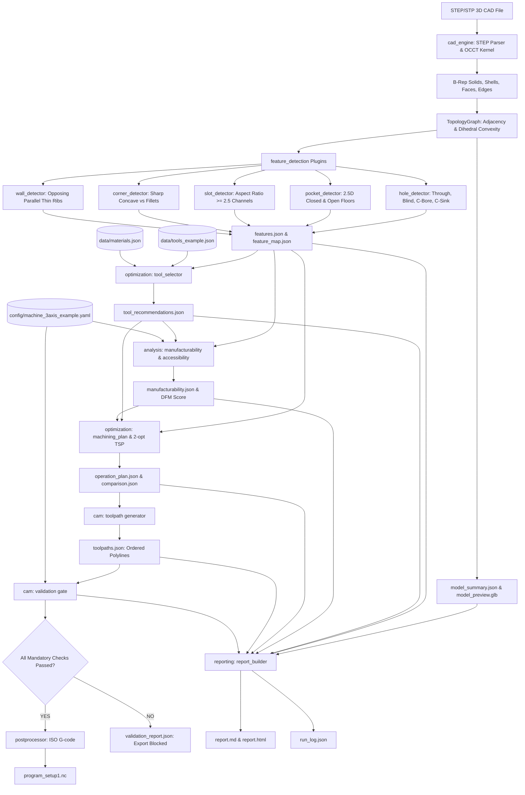

# Engine Architecture and Data Flow

This document details the software architecture, modular layer boundaries, data flow pipelines, and Phase 2 backend/frontend integration strategy for the CAD-to-CNC Optimization Engine.

---

## 1. System Architecture Overview

The engine is structured as a strict single-direction pipeline where geometry and manufacturing data flow from low-level CAD representations to actionable CNC manufacturing programs.



---

## 2. Module Responsibilities and Layer Isolation

Each layer has strictly defined boundaries with no circular or reverse dependencies:

| Module Directory | Key Files | Inputs | Outputs | Non-Negotiable Boundary Rules |
| :--- | :--- | :--- | :--- | :--- |
| `src/cadcnc/schemas/` | `cad.py`, `features.py`, `config.py`, `cam.py`, `run_log.py` | Python primitive types | Versioned Pydantic v2 models | Contains data schemas only; zero business logic. |
| `src/cadcnc/cad_engine/` | `parser.py`, `geometry.py`, `topology.py`, `tessellate.py` | STEP CAD file | `TopoDS_Shape`, `TopologyGraph`, `.glb` preview | Only knows pure B-Rep geometry and topology. Zero CAM or tool logic. |
| `src/cadcnc/feature_detection/`| `registry.py`, `hole_detector.py`, `pocket_detector.py`, etc. | `TopologyGraph`, `TopoDS_Solid` | `FeaturesCollection` | Pluggable modules behind `FeatureDetector` base class. Evaluates geometry only. |
| `src/cadcnc/analysis/` | `manufacturability.py`, `accessibility.py` | Features, Machine config | `ManufacturabilityReport` | Evaluates DFM rules, machine envelope, setup orientations. |
| `src/cadcnc/optimization/` | `tool_selector.py`, `machining_plan.py`, `sequencing.py` | Features, Tools DB, Materials DB | `MachiningPlan`, `ComparisonReport` | Scores tools, groups operations by tool, runs 2-opt TSP. |
| `src/cadcnc/cam/` | `operations.py`, `toolpath.py`, `validation.py`, `postprocessor.py` | Machining plan, Features | `ToolpathsCollection`, G-code `.nc` | Strictly gated: G-code is written ONLY if all validation checks pass. |
| `src/cadcnc/reporting/` | `report_builder.py` | All stage schemas | `report.md`, `report.html` | Deterministic template-driven report generation without external LLM dependencies. |
| `src/cadcnc/` | `engine.py`, `cli.py` | File paths / CLI flags | `EngineRunResult` | Single entry point (`Engine.run(request)`). Zero global mutable state. |

---

## 3. Phase 2 Readiness Strategy

The engine is engineered specifically so Phase 2 (FastAPI REST service + React/Three.js interactive web UI) wraps it as an external package without rewriting core code:

1. **Single Entry Point**:
   ```python
   engine = Engine()
   result: EngineRunResult = engine.run(EngineRunRequest(model_path="...", out_dir="..."))
   ```
2. **REST API Mapping (FastAPI)**:
   - `POST /api/v1/jobs/submit` uploads a STEP file and calls `Engine.run()` in a background worker.
   - `GET /api/v1/jobs/{job_id}/status` streams progress updates from the `progress_cb` hook.
   - `GET /api/v1/jobs/{job_id}/results` returns `EngineRunResult` serialised to JSON.
   - `GET /api/v1/jobs/{job_id}/preview` serves `model_preview.glb`.
   - `GET /api/v1/jobs/{job_id}/gcode` downloads `program_setup1.nc`.
3. **Frontend Integration (React + Three.js)**:
   - `model_preview.glb` renders immediately in Three.js / `@react-three/fiber`.
   - `feature_map.json` maps each B-Rep `face_id` to its detected `feature_id`, allowing users to click a 3D face in the browser to highlight the corresponding hole, pocket, or DFM warning card.
   - `toolpaths.json` contains 3D polyline coordinates with move types (rapid, cut, plunge, retract), enabling real-time animated 3D toolpath backplotting.
