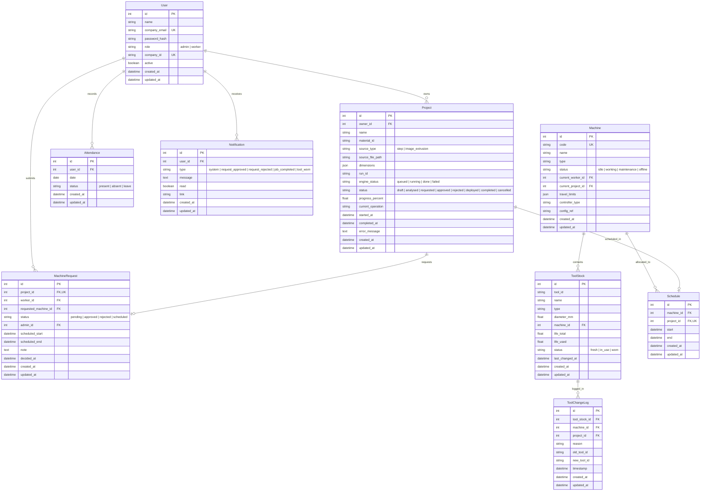

# Mechnova CAD-to-CNC Platform: Data Model Documentation

This document describes the relational database schema implemented via SQLAlchemy 2 and managed with Alembic.

---

## 1. Entity Relationship Overview

---

## 2. Table Specifications

### 2.1 `users`
Represents shop administrators and machine operators.
- `id` (Integer, Primary Key)
- `name` (String, 100) — Full name of the user
- `company_email` (String, 150, Unique, Index) — Corporate authentication email
- `password_hash` (String, 255) — Argon2 cryptographic hash
- `role` (String, 20) — Access tier: `"admin"` or `"worker"`
- `company_id` (String, 50, Unique, Index) — Corporate badge identifier (e.g., `ADM-001`, `WRK-001`)
- `active` (Boolean, Default True) — Whether the account can authenticate
- `created_at`, `updated_at` (DateTime UTC)

### 2.2 `machines`
Shop CNC machine tools available for jobs.
- `id` (Integer, Primary Key)
- `code` (String, 50, Unique, Index) — Shop floor asset code (e.g., `M-01`, `M-02`)
- `name` (String, 100) — Machine model name (e.g., `Haas VF-2`)
- `type` (String, 50) — Machine architecture (e.g., `3-Axis Vertical Mill`)
- `status` (String, 30) — Operational state: `"idle"`, `"working"`, `"maintenance"`, `"offline"`
- `current_worker_id` (Integer, Nullable, FK `users.id`) — Operator assigned to active job
- `current_project_id` (Integer, Nullable, FK `projects.id`) — Job currently on machine
- `travel_limits` (JSON) — Envelope boundaries: `{"x": 762.0, "y": 406.0, "z": 508.0}`
- `controller_type` (String, 50) — CNC dialect: `Haas NGC`, `Siemens 840D`, etc.
- `config_ref` (String, 100) — Engine config reference mapping to YAML

### 2.3 `tool_stock`
Physical drill-bits, end mills, and cutters in carousels and tool cribs.
- `id` (Integer, Primary Key)
- `tool_id` (String, 100, Index) — Matches engine tool catalog ID (e.g., `EM_10MM_CRB_4F`)
- `name` (String, 150) — Descriptive name
- `type` (String, 50) — Tool geometry: `end_mill`, `drill`, `face_mill`, `tap`, `chamfer`
- `diameter_mm` (Float) — Nominal diameter
- `machine_id` (Integer, Nullable, FK `machines.id`) — Loaded in machine spindle/carousel, or crib if null
- `life_total` (Float) — Rated tool life capacity (cutting minutes or operations)
- `life_used` (Float) — Accumulated cutting minutes or operations
- `status` (String, 30) — State: `"fresh"`, `"in_use"`, `"worn"`
- `last_changed_at` (DateTime)

### 2.4 `attendance`
Daily employee shop-floor clock records.
- `id` (Integer, Primary Key)
- `user_id` (Integer, FK `users.id`, Index)
- `date` (Date) — Calendar date
- `status` (String, 20) — Status: `"present"`, `"absent"`, `"leave"`

### 2.5 `projects`
CAD models submitted by workers for engine analysis, planning, and deployment.
- `id` (Integer, Primary Key)
- `owner_id` (Integer, FK `users.id`, Index) — Worker who created the project
- `name` (String, 150) — Part project name
- `material_id` (String, 50) — Workpiece material key (e.g., `aluminum_6061`)
- `source_type` (String, 30) — Input type: `"step"` or `"image_extrusion"`
- `source_file_path` (String, 255) — File system storage path
- `dimensions` (JSON) — `{"length": float, "width": float, "height": float}`
- `run_id` (String, Nullable, 100) — Corresponds to `runs/<run_id>/` output directory
- `engine_status` (String, 30) — Engine execution stage: `"queued"`, `"running"`, `"done"`, `"failed"`
- `status` (String, 30) — Lifecycle state: `"draft"`, `"analysed"`, `"requested"`, `"approved"`, `"rejected"`, `"deployed"`, `"completed"`, `"cancelled"`
- `progress_percent` (Float) — Simulated production progress (0.0 to 100.0)
- `current_operation` (String, Nullable, 100) — Active machining step (e.g., `"pocketing_setup1"`)
- `started_at`, `completed_at` (DateTime, Nullable)
- `error_message` (Text, Nullable)

### 2.6 `machine_requests`
Formal job dispatch requests submitted by workers to shop administrators.
- `id` (Integer, Primary Key)
- `project_id` (Integer, Unique, FK `projects.id`)
- `worker_id` (Integer, FK `users.id`)
- `requested_machine_id` (Integer, Nullable, FK `machines.id`)
- `status` (String, 30) — Request state: `"pending"`, `"approved"`, `"rejected"`, `"scheduled"`
- `admin_id` (Integer, Nullable, FK `users.id`) — Admin who reviewed request
- `scheduled_start`, `scheduled_end` (DateTime, Nullable)
- `note` (Text, Nullable)
- `decided_at` (DateTime, Nullable)

### 2.7 `schedules`
Conflict-free machine reservations.
- `id` (Integer, Primary Key)
- `machine_id` (Integer, FK `machines.id`, Index)
- `project_id` (Integer, Unique, FK `projects.id`)
- `start` (DateTime) — Start timestamp
- `end` (DateTime) — End timestamp

### 2.8 `tool_change_logs`
Audit trail of automatic and manual tool swaps.
- `id` (Integer, Primary Key)
- `tool_stock_id` (Integer, FK `tool_stock.id`)
- `machine_id` (Integer, Nullable, FK `machines.id`)
- `project_id` (Integer, Nullable, FK `projects.id`)
- `reason` (String, 150) — Explanation (e.g., "Heuristic wear threshold exceeded")
- `old_tool_id` (String, 100)
- `new_tool_id` (String, 100)
- `timestamp` (DateTime)

### 2.9 `notifications`
User alerts and job state change notifications.
- `id` (Integer, Primary Key)
- `user_id` (Integer, FK `users.id`, Index)
- `type` (String, 50) — Notification classification
- `message` (Text) — Text message
- `read` (Boolean, Default False)
- `link` (String, Nullable, 255)
