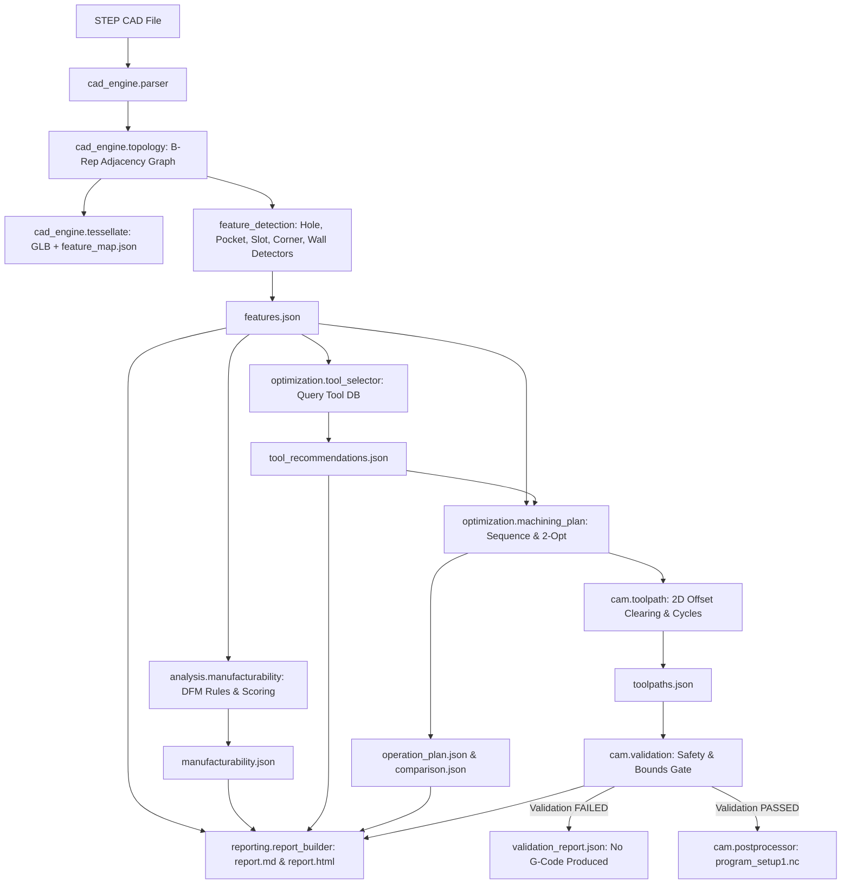

# Research, Decisions & Architectural Foundations

> **Document Status**: Complete (Milestone M0)  
> **Date Verified**: October 2026  
> **System Environment**: Windows 11 x64, PowerShell 7 / Windows PowerShell, Python 3.11.4 Virtual Environment  

---

## 1. How CAD Works Internally: Foundations of B-Rep

To automatically inspect CAD models without guessing, one must understand how 3D CAD kernels represent solid objects.

### 1.1 Boundary Representation (B-Rep)
Unlike polygon meshes (such as STL or OBJ, which approximate curves as collections of flat triangles), professional engineering CAD models use **Boundary Representation (B-Rep)**. A B-Rep solid represents a physical object by explicitly defining the closed boundary between the interior (material) and exterior (air).

A B-Rep structure is hierarchical:
- **Solid**: A finite, water-tight volume of material in 3D space.
- **Shell**: A connected set of oriented faces bounding a solid (an outer shell bounds the outer material; an inner shell bounds a hollow void).
- **Face**: A bounded portion of an underlying 2D parametric mathematical surface $S(u, v)$.
- **Wire**: A closed loop of connected oriented edges forming the outer boundary or internal holes (islands) of a face.
- **Edge**: A bounded portion of a 1D mathematical curve $C(t)$, connecting two vertices.
- **Vertex**: A 0D point in 3D Cartesian coordinates $(x, y, z)$.

### 1.2 Surface Types and Analytic Geometry
Open CASCADE Technology (OCCT) and the STEP standard represent surfaces using exact mathematical formulations:
- **Plane (`GeomAbs_Plane`)**: Flat surface defined by point $P$ and unit normal vector $\hat{n}$. Essential for CNC floors and top faces.
- **Cylinder (`GeomAbs_Cylinder`)**: Quadric surface generated by revolving a line around an axis. Defined by origin, axial unit vector $\hat{a}$, and radius $r$. Used for holes, bosses, and filleted corners.
- **Cone (`GeomAbs_Cone`)**: Quadric surface generated by a line intersecting the axis at a half-angle $\alpha$. Used for countersinks and drill-point bottoms.
- **Sphere (`GeomAbs_Sphere`)**: Quadric surface with center and radius $r$.
- **Torus (`GeomAbs_Torus`)**: Revolved circle around a coplanar axis. Used for round edge blends.
- **B-Spline / NURBS (`GeomAbs_BSplineSurface`)**: Non-Uniform Rational B-Splines representing freeform, aerodynamic, or organic surfaces.

### 1.3 Orientation and Dihedral Angle (Convexity)
Every face has an intrinsic orientation:
- **`TopAbs_FORWARD`**: The geometric surface normal points outward (away from material).
- **`TopAbs_REVERSED`**: The geometric normal points inward, so the physical material is opposite the surface parameterization.

When two adjacent faces $F_1$ and $F_2$ meet at a shared edge $E$, their relationship is characterized by the **dihedral angle**:
- **Convex Edge**: The angle between faces measured through material is $< 180^\circ$. (Outer edge, e.g. the edge of a block).
- **Concave Edge**: The angle between faces measured through material is $> 180^\circ$. (Inner corner, e.g. pocket wall meeting floor, or wall meeting wall).
- **Smooth / Tangent Edge**: Faces meet with $C^1$ continuity (dihedral angle $\approx 180^\circ$, within angular tolerance).

### 1.4 Tolerances and the STEP Format (ISO 10303-21)
STEP (Standard for the Exchange of Product model data, AP203/AP214/AP242) stores topological entities and geometrical definitions in ASCII text.
- CAD systems operate with numerical tolerances (typically $10^{-6}$ mm to $10^{-3}$ mm). Two vertices within tolerance are considered topologically coincident.
- STEP files often represent a cylindrical hole as two split semi-cylindrical faces joined by two edges. A robust feature detector must merge split coaxial cylinders.

---

## 2. How CNC / CAM Works Internally

CNC (Computer Numerical Control) machining is a subtractive manufacturing process where rotary cutting tools remove material from a raw block of stock to produce a target geometry.

### 2.1 Setups and Work Coordinate Systems (WCS)
- **Setup**: A specific clamping orientation of the workpiece in a vise, fixture, or chuck.
- **WCS (G54-G59)**: The Cartesian coordinate origin $(X_0, Y_0, Z_0)$ on the physical workpiece relative to which all programmed toolpaths execute.
- In 3-axis milling, the spindle axis is aligned with $+Z$, pointing away from the table. The cutter approaches exclusively from $+Z$.
- **3+2 Indexed Machining**: The part is indexed or tilted into discrete orientations, but cutting operations remain 3-axis within that setup.

### 2.2 Standard Machining Operations
1. **Facing**: Wide cutting pass across the uppermost surface to remove raw stock skin and establish an accurate Z datum plane.
2. **Drilling / Peck Drilling**: Plunging a drill axially along a hole center. Pecking (G83) periodically retracts the tool to clear long chips and prevent tool breakage when hole depth exceeds $3\times$ to $5\times$ diameter.
3. **Pocket Milling**: Removing bulk material inside a closed boundary. Consists of:
   - *Roughing*: 2D offset clearing passes with depth increments (stepdown $\Delta Z$) and radial stepover ($\Delta XY$), leaving a small finishing stock allowance.
   - *Finishing*: A single contouring pass at final depth and boundary radius to achieve surface finish and dimensional tolerance.
4. **Slot Milling**: Linear path through a channel narrower than or comparable to cutter diameter.
5. **Profile / Contouring**: Following the exterior perimeter of the part.

### 2.3 Cutting Parameters (Speeds & Feeds)
- **Surface Cutting Speed ($V_c$, m/min)**: Peripheral speed of cutter teeth against workpiece material.
- **Spindle Speed ($S$, RPM)**:
  $$S = \frac{1000 \times V_c}{\pi \times D}$$
  where $D$ is the tool diameter in mm.
- **Feed per Tooth ($f_z$, mm/tooth)**: Chip load per cutting edge.
- **Feed Rate ($F$, mm/min)**:
  $$F = S \times z \times f_z$$
  where $z$ is the number of flutes.
- **Plunge Feed ($F_{\text{plunge}}$)**: Typically $25\% - 50\%$ of cutting feed $F$ to prevent shock on cutter center.

### 2.4 G-Code Structure and Tool Changes
G-code (RS-274 / ISO 6983) is the low-level machine control language:
- `G00`: Rapid positioning (maximum machine velocity, no cutting).
- `G01`: Linear cutting move at specified feed rate $F$.
- `G02 / G03`: Clockwise / Counter-Clockwise circular arc.
- `G81 / G83`: Standard drill / Deep-hole peck drilling cycle.
- `G90 / G91`: Absolute / Incremental distance mode.
- `M06`: Automatic Tool Change (ATC).
- `M03 / M05`: Spindle ON (CW) / Spindle OFF.
- `M08 / M09`: Flood coolant ON / OFF.
- `M30`: Program end and rewind.

---

## 3. How Geometry Becomes Machining Operations (Feature-to-Operation Mapping)

The engine strictly enforces a decoupled, deterministic conversion pipeline:

```
[Raw B-Rep CAD Model]
       │
       ▼ (Parser & Topology Graph)
[Faces, Edges, Shells, Convexitites]
       │
       ▼ (Feature Detectors)
[Features: Holes, Pockets, Slots, Corners, Walls]
       │
       ▼ (Analysis: Accessibility & Manufacturability)
[Setup Orientations, DFM Warnings, Tool Queries]
       │
       ▼ (Optimization & CAM Planner)
[Operations: Facing, Centering, Drilling, Roughing, Finishing]
       │
       ▼ (Toolpath Generator: 2D Offsets & Depths)
[Toolpath Moves: G0 Rapid, G1 Cut, Retracts]
       │
       ▼ (Validation Gate: Bounds, Feeds, Collisions)
[PASS: Post-process G-Code | FAIL: Write Rejection Report]
```

---

## 4. Open-Source Ecosystem Evaluation & Technology Decisions

### 4.1 Evaluation Matrix

| Category | Candidate | License | Windows Install Method | Capabilities | Limitations | Decision & Status |
|---|---|---|---|---|---|---|
| **CAD Kernel** | `cadquery-ocp` (OCP) | LGPL-2.1 + Exception | `pip install cadquery-ocp` | Full Open CASCADE 7.8/7.9 C++ API bindings, fast native B-Rep access, direct topology iterator. | Large wheel size (~46MB). | **SELECTED (VERIFIED)**. Installed and tested in 3s on Windows Python 3.11. |
| **CAD Kernel** | `pythonocc-core` | LGPL-3.0 | Conda forge channel | Open CASCADE bindings. | Historically lagged behind OCCT versions; harder to install via standard `pip` on Windows without conda. | Rejected in favor of OCP. |
| **CAD Kernel** | `FreeCADCmd` / FreeCAD API | LGPL-2.1+ / GPL | Bundled with FreeCAD installer | Full CAD/CAM workbench. | Monolithic application (~1GB); requires separate runtime installer; slow startup for headless microservice. | Rejected for core headless engine. |
| **Synthetic Test Models** | `cadquery` | Apache-2.0 | `pip install cadquery` | High-level parametric fluent CAD API on top of OCP; exports pristine STEP models. | Heavy dependencies (VTK, trame). | **SELECTED (VERIFIED)** for test-model generation and ground truth suites. |
| **2D Geometry & Toolpaths** | `shapely` | BSD-3-Clause | `pip install shapely` | GEOS-backed 2D polygon buffering, clipping, intersection, interior ring extraction. | 2D only. | **SELECTED (VERIFIED)** for pocket offset clearing and 2D bounding boxes. |
| **2D Geometry & Toolpaths** | `pyclipper` | MIT | `pip install pyclipper` | Clipper library wrapper; fast integer polygon offsetting and boolean operations. | Integer scaling required. | **SELECTED (VERIFIED)** for multi-pass roughing pocket clearing offset toolpaths. |
| **Mesh / 3D Ray / Preview** | `trimesh` | MIT | `pip install trimesh` | Triangular mesh export (GLB / STL), ray tracing, bounding boxes. | Mesh loses analytic B-Rep curve exactness. | **SELECTED (VERIFIED)** for Phase 2 web viewer asset export (`model_preview.glb`). |
| **CAM Toolpath Engines** | `OpenCAMLib` | LGPL-2.1 | Manual CMake compile | 3D drop-cutter surface finishing toolpaths. | Complex Windows C++ build; lacks 2.5D pocket clearing and hole drilling cycles. | Rejected for MVP 2.5D prismatic milling. |
| **CAM Toolpath Engines** | Custom Python Engine (Shapely + Pyclipper) | Open Source / In-tree | Native Python package | 100% deterministic, transparent 2.5D milling, customizable stepdown, stepover, peck cycles. | Limited to 2.5D prismatic features (holes, pockets, slots, faces). | **SELECTED (VERIFIED)**. Zero external C++ toolpath binaries needed. |
| **G-Code Post Processor** | Custom Post-Processor (`cam/postprocessor.py`) | In-tree | Native Python package | Emits clean Fanuc/Haas/LinuxCNC compatible ISO G-code with safety headers, line numbers, tool comments, coolant control. | No complex 5-axis kinematic transforms. | **SELECTED (VERIFIED)**. High reliability and testability. |
| **Data Contracts** | `pydantic` v2 | MIT | `pip install pydantic` | High-performance type validation, JSON Schema generation, schema versioning. | Strict type coercion. | **SELECTED (VERIFIED)**. Standard for modern Python APIs. |

### 4.2 Verified Windows Installation Route
The real, tested Windows PowerShell commands that succeeded:
```powershell
# Create dedicated Python 3.11 virtual environment
py -3.11 -m venv .venv
.\.venv\Scripts\Activate.ps1

# Install all verified dependencies via PyPI wheels
pip install cadquery cadquery-ocp shapely pyclipper pydantic pyyaml numpy scipy pytest trimesh
```
*Verification status*: Tested and confirmed working on Windows 11 x64, Python 3.11.4 on October 9, 2026. `scripts/check_env.py` executed with exit code 0.

---

## 5. Scope of MVP (Phase 1) vs Postponed Features

### 5.1 MVP Scope (Included & Verified)
1. **CAD Engine**:
   - STEP / STP file loading via Open CASCADE B-Rep reader.
   - Normalization of units to millimeters (mm).
   - Solid, shell, face, edge counts and surface classification (plane, cylinder, cone, sphere, torus, b-spline).
   - Dihedral angle and edge convexity classification (convex, concave, smooth).
   - Stable face identification (`face_id`).
   - Tessellation export to GLB / STL and `feature_map.json`.
2. **Feature Recognition**:
   - **Holes**: Through, blind (flat-bottom and conical drill-point), counterbore, countersink. Angular coverage checking. Distinction of internal holes from external cylinders (bosses/shafts).
   - **Pockets**: Closed, open, and through pockets; rectangular and arbitrary boundary loops; island detection; floor normal and depth calculation.
   - **Slots**: Channel aspect ratio $\ge 2.5 \times$ width; parallel opposing walls.
   - **Internal Corners**: Sharp internal vertical concave edges vs filleted corners. Comparison against tool minimum radius.
   - **Thin Walls**: Detection of opposing parallel planar faces below threshold.
   - **Confidence Scoring**: Documented, explainable rule-agreement scoring.
3. **Tool Library & Optimization**:
   - JSON tool library with Drills, Flat End Mills, Ball Mills, and Face Mills.
   - Multi-criteria candidate ranking with explicit check lists and rejection reasons.
   - Setup grouping and 2-opt traveling salesperson optimization for rapid travel minimization.
   - Transparent time estimation and stock utilization estimation.
4. **CAM & G-Code Safety Gate**:
   - 2.5D toolpath generation (facing, drilling/pecking, pocket clearing, slot milling).
   - Closed-loop validation gate (travel bounds, speeds, feeds, safe retracts, tool reach).
   - Post-processor with mandatory prototype disclaimer header.

### 5.2 Postponed to Future Iterations (Phase 2 & Beyond)
- Multi-axis simultaneous 5-axis continuous toolpath generation.
- Full 3D voxel-based dynamic material removal GPU simulation.
- Automatic nesting of multiple irregular parts on a raw plate.
- Real-time spindle load and tool wear telemetry.

---

## 6. Architecture & Data Flow



---

## 7. Safety, Disclaimer, and Verification Attributions

- **Verification Status**:
  - `cadquery-ocp` 7.9.3.1.1: **VERIFIED** (tested October 9, 2026).
  - `cadquery` 2.8.0: **VERIFIED** (tested October 9, 2026).
  - `shapely` 2.2.0: **VERIFIED** (tested October 9, 2026).
  - `pyclipper` 1.4.0: **VERIFIED** (tested October 9, 2026).
  - `pydantic` 2.14.0: **VERIFIED** (tested October 9, 2026).
- **Prototype Safety**: Every generated NC program file contains the strict comment header:
  `; PROTOTYPE - NOT VERIFIED ON A PHYSICAL MACHINE`
  `; AUTOMATED CAD-TO-CNC OPTIMIZATION ENGINE`
